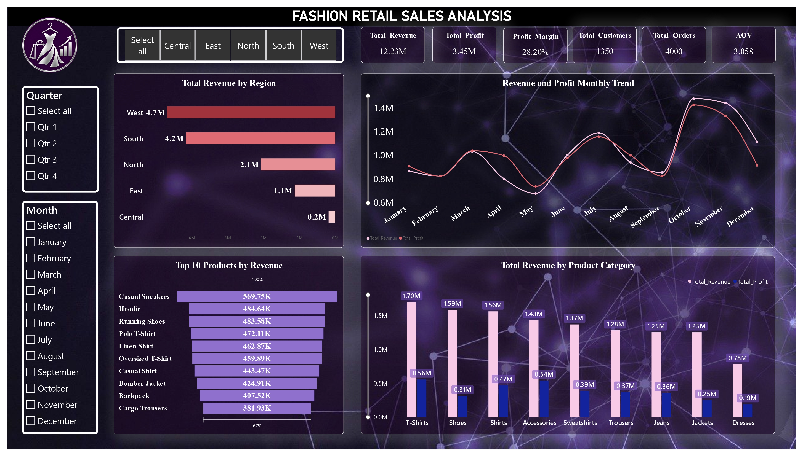
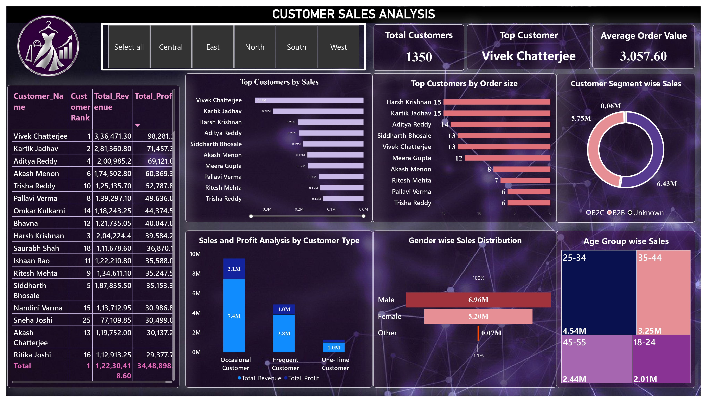
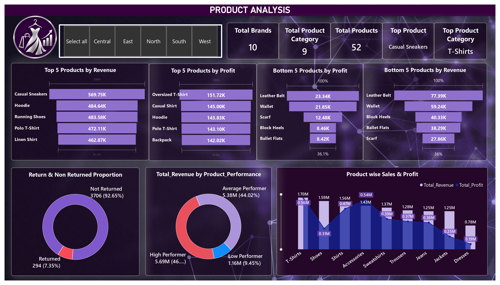
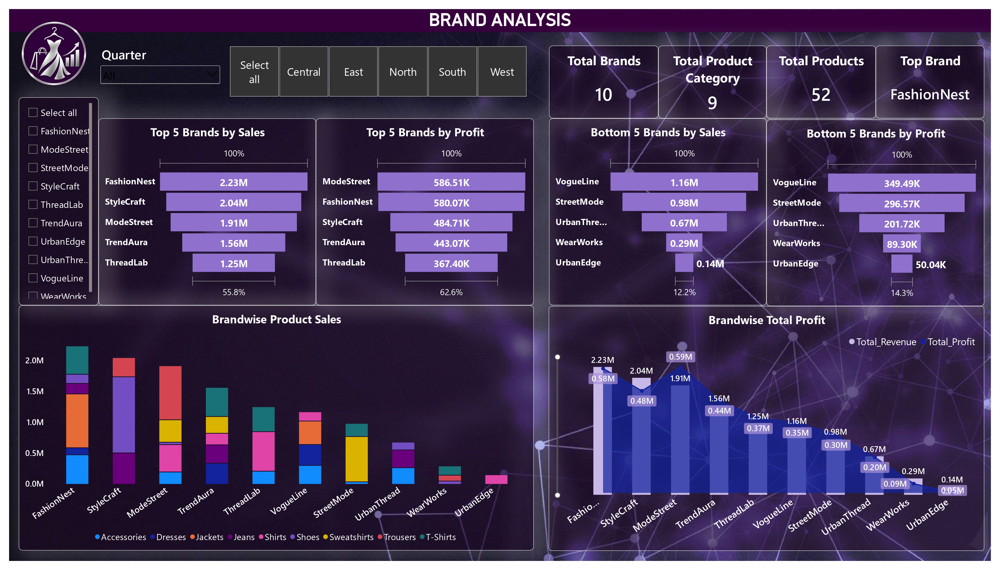

# Fashion Retail Sales Analysis -- Power BI Dashboard

## Project Overview

This project analyzes fashion retail sales, customer behavior, product
performance, and brand performance using **Power BI**. The dashboard
turns retail data into interactive reports to help identify revenue
trends, profitable products, customer segments, and brand performance.

## Project Objectives

-   Monitor revenue, profit, order volume, customer count, and average
    order value.
-   Compare sales performance across regions and months.
-   Identify top- and low-performing products and categories.
-   Analyze customer spending, order size, customer type, gender, and
    age-group patterns.
-   Compare brand revenue and profit.
-   Present findings through interactive dashboards and filters.

## Tools Used

-   **Power BI** -- dashboard design and data visualization
-   **Power Query** -- data preparation and transformation
-   **DAX** -- measures and KPI calculations

## Key Performance Indicators

  KPI                            Result
  --------------------------- ---------
  Total Revenue                 ₹12.23M
  Total Profit                   ₹3.45M
  Profit Margin                  28.20%
  Total Customers                 1,350
  Total Orders                    4,000
  Average Order Value (AOV)      ₹3,058

## Dashboard Pages

### 1. Executive Dashboard

Shows overall business performance, key KPIs, revenue by region, monthly
revenue and profit trends, top products by revenue, and revenue by
product category.



### 2. Customer Sales Analysis

Explores customer sales and profit, customer rankings, order size,
customer segments, customer types, gender-wise sales, and sales by age
group.



### 3. Product Analysis

Compares top and bottom products by revenue and profit, returned versus
non-returned orders, product performance, and category-level sales.



### 4. Brand Analysis

Compares brands by sales and profit, highlights the top and bottom
brands, and displays brand-wise product sales and total profit.



## Key Insights

-   The dashboard reports **₹12.23M in revenue** and **₹3.45M in
    profit**, with a **28.20% profit margin**.
-   The **West** region has the highest revenue among the regions shown.
-   **October** is the strongest month by revenue in the displayed
    monthly trend.
-   **Casual Sneakers** is the top product by revenue, at approximately
    **₹569.75K**.
-   **T-Shirts** is the leading product category by revenue, at
    approximately **₹1.70M**.
-   **FashionNest** leads the displayed brands by revenue, while
    **ModeStreet** leads the displayed top five brands by profit.
-   The return analysis shows **294 returned orders (7.35%)** and
    **3,706 non-returned orders (92.65%)**.

These observations describe patterns shown in the dashboard and do not,
by themselves, establish the causes behind sales or profit differences.

## Interactive Features

Filters and slicers let users explore data by fields such as region,
quarter, month, and brand.

## Repository Structure

``` text
Fashion-Retail-Sales-Analysis/
├── README.md
├── Fashion_Retail_Sales.pbix
└── images/
    ├── Executive_Dashboard.jpg
    ├── Customer_Analysis.jpg
    ├── Product_Analysis.jpg
    └── Brand_Analysis.jpg
```

Ensure the image filenames and folder names in your repository match the
paths used above. If your Power BI file has a different name, update the
repository structure accordingly.

## How to Use

1.  Download or clone this repository.
2.  Open the `.pbix` file in Microsoft Power BI Desktop.
3.  Use the slicers and filters to explore the dashboard.
4.  Refer to the screenshots above for a preview of each page.

## Conclusion

This project demonstrates how Power BI can be used to build an
interactive retail analytics dashboard covering overall sales, customer
behavior, product performance, and brand profitability. It showcases
practical skills in KPI reporting, data visualization, and communicating
data-driven business insights.
